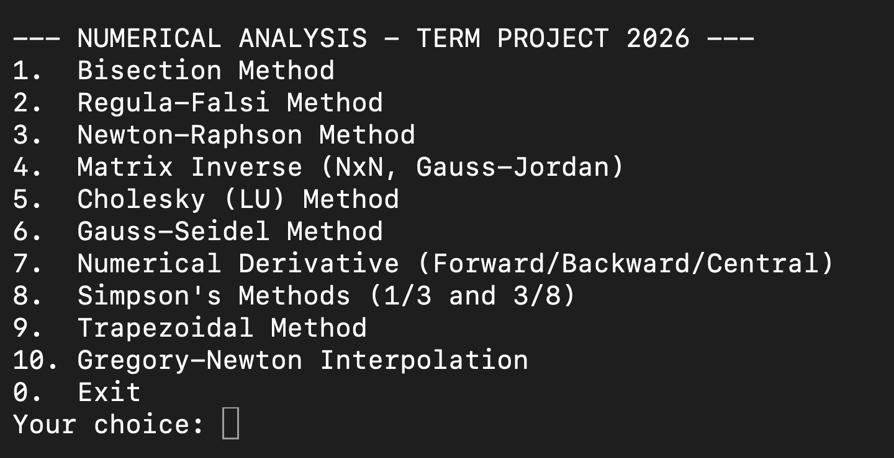
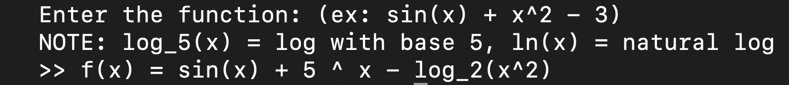

<div align="center">

# 📐 Numerical Analysis in C

**Root finding, linear algebra, differentiation, integration and interpolation — in a single terminal app with its own expression parser.**

[](https://en.cppreference.com/w/c/99)
[](#-build-and-run)
[](#-available-methods)
[](#-build-and-run)

[Türkçe](README.tr.md) · **English**



</div>

---

Developed for a **Structured Programming** course, this project performs numerical computations on user-supplied functions and matrices. Mathematical expressions are parsed at runtime, and each method reports its results as roots, error estimates, iteration counts, matrices, or solution vectors.

No external numerical library is used — the algorithms, expression parser and memory management are all implemented in plain C.

## 📑 Contents

- [Available methods](#-available-methods)
- [Build and run](#-build-and-run)
- [Function syntax](#%EF%B8%8F-function-syntax)
- [Example: finding √2](#-example-finding-2)
- [How it works](#%EF%B8%8F-how-it-works)
- [Project files](#-project-files)
- [Usage notes](#-usage-notes)

## 🧮 Available methods

| Menu | Category | Method | Purpose |
| :---: | --- | --- | --- |
| 1 | 🎯 Root finding | Bisection | Halve a sign-changing interval repeatedly |
| 2 | 🎯 Root finding | Regula-Falsi | Find a root using linear interpolation |
| 3 | 🎯 Root finding | Newton-Raphson | Iterate from an initial estimate using a numerical derivative |
| 4 | 🔢 Linear algebra | Gauss-Jordan | Compute the inverse of an N × N matrix |
| 5 | 🔢 Linear algebra | Cholesky (LU)\* | Solve a linear system through triangular factorization |
| 6 | 🔢 Linear algebra | Gauss-Seidel | Solve a linear system iteratively |
| 7 | 📈 Calculus | Numerical differentiation | Forward, backward and central differences together |
| 8 | 📈 Calculus | Simpson's 1/3 and 3/8 | Two numerical integration approximations together |
| 9 | 📈 Calculus | Trapezoidal rule | Approximate a definite integral using trapezoids |
| 10 | 📊 Interpolation | Gregory-Newton | Interpolate equally spaced data using forward differences |

> [!NOTE]
> \* The menu labels this method “Cholesky (LU).” The implementation actually performs **Crout-style LU factorization** with a unit diagonal in `U`, rather than the classical `A = L Lᵀ` Cholesky factorization.

## 🚀 Build and run

**Requirements:** GCC or Clang with C99 support and a terminal. Run from the project directory.

<table>
<tr><th>🐧 Linux / 🍎 macOS</th><th>🪟 Windows (MinGW-w64 / GCC)</th></tr>
<tr>
<td>

```bash
cc -std=c99 -O2 numerical_analysis.c -o program -lm
./program
```

</td>
<td>

```powershell
gcc -std=c99 -O2 numerical_analysis.c -o program.exe -lm
.\program.exe
```

</td>
</tr>
</table>

`-lm` links the math library. Once the app starts, enter a method number and follow the prompts. Select `0` in the main menu to exit.

## ✏️ Function syntax

Enter the expression alone, without an `f(x) =` prefix.



| Element | Supported syntax |
| --- | --- |
| Variable and constant | `x`, `pi` |
| Arithmetic operators | `+` `-` `*` `/` `^` |
| Grouping | `(` `)` |
| Trigonometric | `sin`, `cos`, `tan`, `cot` |
| Inverse trigonometric | `arcsin`, `arccos`, `arctan` |
| Exponential / logarithmic | `exp(x)`, `ln(x)`, `log(x)` |
| Logarithm with a base | `log_5(x)`; `log_x(8)` for a variable base |

**Example expressions:**

```text
x^3 - 2*x - 5
sin(x) + x^2 - 3
exp(x) - 4
ln(x) + log_2(x)
cos(pi*x)
```

> [!TIP]
> - Write multiplication explicitly: `2*x`, `2*(x+1)`.
> - Use a decimal point: `0.001`.
> - Use lowercase function names. Trigonometric angles are in **radians**.
> - `ln` is the natural logarithm; `log` is base 10.
> - Use `x^0.5` for a square root — `sqrt` is not defined.

## 🎯 Example: finding √2

Select **1 — Bisection Method** and enter:

| Parameter | Value |
| --- | --- |
| Function | `x^2 - 2` |
| Decimal places | `6` |
| Lower bound | `1` |
| Upper bound | `2` |
| Tolerance | `0.000001` |
| Maximum iterations | `100` |

```text
--- RESULT ---
  Root      : 1.414214
  Error     : 0.000001
  Iteration : 20
```

For integration, select **8 — Simpson's Methods** with `x^2`, 6 decimal places, interval `[0, 1]` and `n = 6`. Both methods return `0.333333`.

## ⚙️ How it works


The parser converts infix notation to postfix while respecting operator precedence and parentheses. The resulting expression is evaluated at different values of `x` by the root-finding, differentiation and integration methods. Matrices and interpolation tables use dynamically allocated memory.

## 📂 Project files

| File / directory | Contents |
| --- | --- |
| [`numerical_analysis.c`](numerical_analysis.c) | Algorithms, expression parser and terminal menu |
| [`screenshots/`](screenshots/) | Application screenshots |
| [`.gitignore`](.gitignore) | Ignore rules for build outputs, local settings and archives |
| [`README.tr.md`](README.tr.md) | Turkish documentation |
| [`README.md`](README.md) | English documentation |

## 📝 Usage notes

<details>
<summary><b>Show method-specific notes</b></summary>

<br>

- **Bisection / Regula-Falsi:** choose a continuous function and an interval whose endpoints have function values with opposite signs.
- **Newton-Raphson:** uses a numerical derivative. The initial estimate and the nonzero derivative step `h` affect convergence.
- **Gauss-Seidel:** does not converge for every system; diagonally dominant matrices are a useful starting point. The LU implementation does not perform pivoting.
- **Simpson's 1/3:** an odd `n` is increased by one to make it even. **Simpson's 3/8** divides each interval into three subintervals internally, so a positive `n` doesn't need to be a multiple of 3.
- **Gregory-Newton:** requires equally spaced `x` values.
- The decimal-place setting controls output formatting; convergence tolerance is a separate parameter.
- Input validation is limited. Use valid expressions, positive dimensions and parameters appropriate for the selected method. Respect the domains of logarithms, division and other operations.

</details>

---

<div align="center">

Made for studying numerical methods in C by [**Yusuf Emir Gökdoğan**](https://github.com/ygokdogan)

</div>
